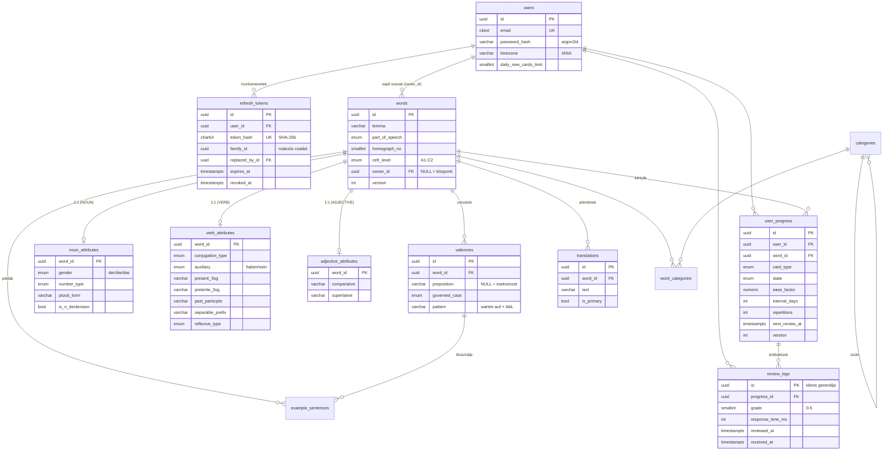

# Fázis 1 – Adatbázis-terv

> Hatókör: PostgreSQL 16 séma, migrációk, indexek. Forrás: [`backend/prisma/schema.prisma`](../backend/prisma/schema.prisma),
> [`migrations/`](../backend/prisma/migrations), ellenőrzés: [`verify/schema-checks.sql`](../backend/prisma/verify/schema-checks.sql).

## 1. Áttekintés

A séma három, egymástól jól elhatárolt tartományból áll:

| Tartomány | Táblák | Írási minta |
|---|---|---|
| **Identitás** | `users`, `refresh_tokens` | ritka írás, gyakori pontszerű olvasás |
| **Szókincs (katalógus)** | `words`, `noun_attributes`, `verb_attributes`, `adjective_attributes`, `valencies`, `translations`, `example_sentences`, `categories`, `word_categories` | főleg olvasás; a központi szótár adminisztrált, a felhasználói szavak (`owner_id`) szinkronizáltak |
| **Tanulás** | `user_progress`, `review_logs` | nagyon gyakori írás (minden értékelés), időalapú lekérdezések |

## 2. ER-diagram



## 3. Architekturális döntések

### D1 – Prisma ORM + kézi SQL migráció
**Döntés:** a séma forrása a `schema.prisma`; az első migráció generált (`prisma migrate diff --from-empty`), a második kézzel írt SQL.
**Indoklás:** a Prisma típusbiztos klienst ad a NestJS rétegnek, de nem modellezi a CHECK kényszereket, részleges indexeket, `NULLS NOT DISTINCT`-et és triggereket. Ezek a domén invariánsainak utolsó védvonalai, ezért nem mondunk le róluk – külön, dokumentált migrációba kerülnek. A `prisma migrate diff --from-url … --to-schema-datamodel` „No difference detected” eredményt ad, vagyis a Prisma nem lát eltérést a két forrás között.
**Verzió:** Prisma 6.19 (a 6.x ág stabil, NestJS-integrációja kiforrott); a 7.x-re váltás külön feladat.

### D2 – UUID elsődleges kulcsok
Offline-first kliensen (Fázis 3) a rekordok szerverkapcsolat nélkül jönnek létre. Szekvenciális kulcsoknál ez ütközést és utólagos ID-átírást okozna; UUID-nél a kliens által adott azonosító végleges. A `review_logs.id`-nak **nincs** szerveroldali alapértéke: a kliens adja, így az offline napló többszöri feltöltése idempotens (`INSERT … ON CONFLICT (id) DO NOTHING`).

### D3 – Nyelvtani attribútumok: szófajonkénti 1:1 altáblák
A specifikáció `grammatical_attributes` fogalmát **class-table inheritance** valósítja meg (`noun_`, `verb_`, `adjective_attributes`). Elvetett alternatívák:
- *Egy közös, széles tábla* – szófajonként más oszlopok kötelezők, ez csak sok NULL-lal és bonyolult CHECK-ekkel írható le.
- *EAV vagy JSONB* – elveszik a típusbiztonság, a NOT NULL és az enum-ellenőrzés; a Prisma kliens sem tud típusos mezőket adni.

A szófaji konzisztenciát **deklaratív** szabály biztosítja trigger nélkül: az altábla `part_of_speech` oszlopa CHECK-kel rögzített (pl. `= 'NOUN'`), a FK pedig kompozit: `(word_id, part_of_speech) → words(id, part_of_speech)`. Így igei attribútumot nem lehet főnévhez kötni, és egy attribútummal rendelkező szó szófaja sem írható át (`ON UPDATE RESTRICT`).

### D4 – Német nyelvtani modellezés
- **Névelő** nem tárolódik szövegként: a `gender` enumból (MASCULINE/FEMININE/NEUTER) származtatható, így nem lehet inkonzisztens. Csak többes számú főnévnek (`die Leute`) nincs neme – ezt CHECK köti a `number_type = 'PLURAL_ONLY'` értékhez.
- **Azonos alakú szavak** (`der See` ‘tó’ / `die See` ‘tenger’) a `homograph_no` mezővel különülnek el; a szó-identitás kulcs `(owner_id, language, lemma, part_of_speech, homograph_no)`.
- **Igék:** a három alapalak (jelen E/3, Präteritum E/3, Partizip II) külön oszlop, mert a tőhangváltás (*fährt*, *fuhr*) nem vezethető le szabállyal. A segédigénél `BOTH` érték kezeli a *fahren* típusú kettősséget. Elváló igekötő és visszahatóság külön mező.
- **Vonzatok** (`valencies`): elöljáró (NULL = tiszta esetvonzat, pl. *helfen + Dat.*) + vonzott eset + reflexivitás. Egy szónak több vonzata lehet (*sich freuen auf / über*); főnévhez és melléknévhez is (*Angst vor + Dat.*, *stolz auf + Akk.*). A példamondat opcionálisan egy konkrét vonzathoz köthető.

### D5 – Központi és felhasználói szókincs egy táblában
`words.owner_id IS NULL` a kurált szótár, egyébként a felhasználó saját szava. Egy táblával a kártyák (`user_progress`) egységesen hivatkoznak bármelyikre. Mivel a PostgreSQL alapértelmezésben két NULL-t különbözőnek tekint, az identitás kulcs `NULLS NOT DISTINCT` (PG 15+) – enélkül a központi szótárban duplikált lemmák keletkezhetnének.

### D6 – `user_progress` pillanatkép + `review_logs` eseménynapló
- `user_progress` az ütemező **aktuális** állapota (SM-2: `ease_factor`, `interval_days`, `repetitions`, `learning_step`; metrikák: `lapses`, `total/correct_reviews`, `avg_response_ms`, `stability_days`). Egy szóból kártyatípusonként (RECOGNITION / PRODUCTION / GENDER) külön, egymástól független kártya lesz.
- `review_logs` **append-only** (UPDATE-et trigger tilt): minden értékelés előtti/utáni állapotot rögzít. Ebből a metrikák (hibagyakoriság, reakcióidő, felejtési görbe – `elapsed_days` vs. `grade`) bármikor újraszámolhatók, és az algoritmus paraméterei utólag kalibrálhatók. A `received_at` (szerveridő) a szinkron-kurzor, a `reviewed_at` (kliensidő) a statisztika alapja.
- Állapotgép-invariánsok CHECK-ként: `state = 'NEW' ⇔ next_review_at IS NULL`; NEW kártyának nincs értékelése; `1.30 ≤ ease_factor ≤ 5.00`; `correct_reviews ≤ total_reviews`.
- `ease_factor` `numeric(4,2)`: pontos decimális tárolás, nincs lebegőpontos sodródás az ismételt szorzások során.

### D7 – Szinkronizációs oszlopok és triggerek
A kliens által is módosítható táblákon `updated_at`, `version`, `deleted_at`:
- **`deleted_at` (soft delete)** – a törlés tombstone-ként szinkronizálható; fizikai törlésnél a többi eszköz nem tudna róla.
- **`updated_at`** – a „mi változott X óta” (pull) lekérdezés alapja. DB-trigger állítja **szerveridőre**, a kliens vagy a Prisma által küldött értéket felülírja (az eszközök órája nem megbízható).
- **`version`** – optimista konkurenciakezelés: `UPDATE … WHERE id = $1 AND version = $2`; a trigger lépteti.
- Valódi adatváltozás nélküli UPDATE egyiket sem lépteti (a seed ismételt futtatása `version = 1`-en hagyja a sorokat), így nincs fölösleges szinkronforgalom.

*Ismert korlát, Fázis 3-ban kezelendő:* a `now()` a tranzakció kezdetének időpontja; egy hosszú tranzakció a kurzornál „korábbi” `updated_at`-tel véglegesedhet. A pull végpont ezért átfedő ablakkal (pl. `since − 5 s`) kérdez, a kliens pedig `version` alapján deduplikál.

### D8 – Refresh tokenek
Csak a token SHA-256 hash-e tárolódik (adatbázis-szivárgás esetén sem használható fel). Rotáció „token family” mintával: minden frissítés új tokent ad ugyanabban a `family_id`-ban, a régi `replaced_by_id`-t kap. Egy már lecserélt token ismételt bemutatása lopásra utal → a teljes család visszavonható. A `device_id` eszközönkénti kijelentkeztetést tesz lehetővé.

### D9 – Integritás az adatbázisban
Minden doménszabály, ami egy soron belül eldönthető, CHECK kényszer (formátum, tartomány, állapot-invariáns). Ezek nem helyettesítik a DTO-validációt (Fázis 2), hanem utolsó védvonalak admin eszközök, migrációk és jövőbeli szolgáltatások ellen.

## 4. Indexstratégia

| Index | Lekérdezés | Indoklás |
|---|---|---|
| `user_progress_due_idx` **(részleges)** `(user_id, next_review_at) WHERE state <> 'NEW' AND NOT is_suspended AND deleted_at IS NULL` | napi esedékes kártyák: `WHERE user_id = $1 AND next_review_at <= $2 … ORDER BY next_review_at LIMIT n` | A leggyakoribb lekérdezés. Egyetlen index range scan, **külön rendezés nélkül** (a `verify` szkript EXPLAIN-nel ellenőrzi). A részleges feltétel miatt az index csak aktívan ütemezett kártyákat tartalmaz → kisebb, melegebb a cache-ben. |
| `user_progress_new_idx` **(részleges)** `(user_id, created_at) WHERE state = 'NEW' …` | napi új kártya keret feltöltése | Az új kártyák kizárólag ebből jönnek; a due indextől elválasztva egyik sem tartalmaz felesleges sort. |
| `user_progress (user_id, word_id, card_type)` UNIQUE | kártya keresése / upsert | Üzleti egyediség + a `user_id` FK indexe. |
| `user_progress (user_id, updated_at)` | szinkron pull | Időbélyeg alapú változáslekérés. |
| `review_logs (user_id, received_at)` | szinkron pull a naplóra | Szerveroldali, monoton kurzor. |
| `review_logs (user_id, reviewed_at)`, `(progress_id, reviewed_at)` | statisztika (napi aktivitás, kártyatörténet) | Idősoros lekérdezések. |
| `words_lemma_trgm_idx`, `translations_text_trgm_idx` (GIN, `pg_trgm`) | szókereső (`ILIKE '%…%'`, `similarity`) | B-tree nem támogatja a nem prefix illesztést. |
| `words (language, cefr_level, part_of_speech)` | szólista szűrése szint/szófaj szerint | Pakli-összeállítás. |
| `word_categories (category_id, word_id)` | „kategória összes szava” | Az összetett PK `(word_id, category_id)` csak a másik irányt szolgálja ki. |
| `refresh_tokens (token_hash)` UNIQUE, `(user_id)`, `(family_id)`, `(expires_at)` | token-ellenőrzés, kijelentkeztetés, lopás-visszavonás, takarító job | |
| `translations_one_primary_key` **(részleges UNIQUE)** | — | Szavanként legfeljebb egy elsődleges fordítás. |

Minden FK-oszlop indexelt (a PostgreSQL nem hoz létre ilyet automatikusan; enélkül a kaszkádolt törlés teljes táblát olvasna).

**Skálázási opció:** a `review_logs` a leggyorsabban növő tábla. Ha meghaladja a ~100 M sort, havi `PARTITION BY RANGE (reviewed_at)` particionálás javasolt; a jelenlegi kulcsok ezt nem akadályozzák (a PK ekkor `(id, reviewed_at)`-re bővül).

## 5. Migrációk

| Migráció | Tartalom | Karbantartás |
|---|---|---|
| `20261014000000_init` | kiterjesztések (`citext`, `pg_trgm`, `pgcrypto`), enumok, táblák, FK-k, Prisma-indexek | generált |
| `20261014000100_constraints_indexes` | CHECK kényszerek, `NULLS NOT DISTINCT` és részleges indexek, `touch_row` / `touch_versioned_row` / `forbid_update` triggerek | kézi |

Új migráció: `npm run db:migrate:dev -- --name <név>` (csak létrehoz, nem alkalmaz) → a generált SQL átnézése → `npm run db:migrate`.

## 6. Ellenőrzés

```bash
cd backend
npm run prisma:validate
npm run db:migrate && npm run db:seed        # a seed idempotens, többször futtatható
npx prisma migrate diff --from-url "$DATABASE_URL" --to-schema-datamodel prisma/schema.prisma --exit-code
npm run db:verify                            # kényszerek, triggerek, EXPLAIN – ROLLBACK-kel zárul
```

A `db:verify` 17 állítást ellenőriz, köztük: igei attribútum nem köthető főnévhez; elöljárós vonzat nem lehet alanyeset; nincs duplikált lemma a központi szótárban; `ease_factor ≥ 1.30`; `grade ∈ [0, 5]`; a `review_logs` nem módosítható; a no-op UPDATE nem lépteti a verziót; az esedékes-kártya lekérdezés a részleges indexet használja.

## 7. Szókészletek (seed)

A központi szótár tartalma a `backend/prisma/vocab/` könyvtárban van, önállóan betölthető készletekre bontva:

| Készlet | Tartalom | Méret |
|---|---|---|
| `core` | a séma határeseteit lefedő minták (der See / die See, die Leute, der Student, sich freuen auf + Akk. …) | 15 szó |
| `b2` | B2 szókincs 14 tematikus kategóriában: főnevek névelővel, többes számmal és birtokos esettel; igék alapalakokkal, segédigével és vonzattal; melléknevek fokozással és vonzattal; főnév-ige kapcsolatok; elöljárók esetvonzattal; kötő- és határozószók | ~1600 szó, ~650 vonzat |

A B2 lista tömör, soronkénti formátumban készült (egy szó = egy sor, lásd `vocab/dsl.ts`); az értelmező minden sort szigorúan ellenőriz (pl. az elváló igekötőnek a lemma elejének kell lennie, nincs ismétlődő vonzat), a szabályos alakokat (birtokos eset, fokozás) szabályból képzi, a kivételeket a sor adja meg. A `prisma/vocab/vocab.spec.ts` egységteszt a teljes készletet ellenőrzi adatbázis nélkül: darabszám, kategóriák, névelő és többes szám megléte, kulcsütközés a készletek között, oszlopméretek.

`npm run db:seed` alapértelmezésben minden készletet betölt; `SEED_SETS=core` csak a mintákat (az integrációs tesztek így futnak, mert a lapozási tesztek kis katalógusra méretezettek).
