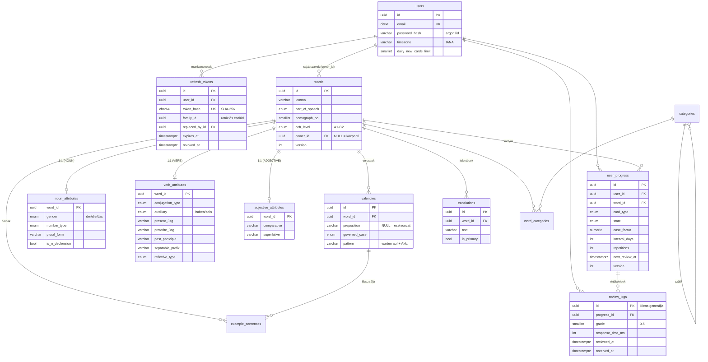

# Fázis 1 – Adatbázis-terv

> Hatókör: PostgreSQL 16 séma, migrációk, indexek. Forrás: [`backend/prisma/schema.prisma`](../backend/prisma/schema.prisma),
> [`migrations/`](../backend/prisma/migrations), ellenőrzés: [`verify/schema-checks.sql`](../backend/prisma/verify/schema-checks.sql).

## 1. Áttekintés

A séma három, egymástól jól elhatárolt tartományból áll:

| Tartomány | Táblák | Írási minta |
|---|---|---|
| **Identitás** | `users`, `refresh_tokens` | ritka írás, gyakori pontszerű olvasás |
| **Szókincs (katalógus)** | `words`, `noun_attributes`, `verb_attributes`, `adjective_attributes`, `valencies`, `translations`, `example_sentences`, `categories`, `word_categories` | főleg olvasás; a központi szótár adminisztrált, a felhasználói szavak (`owner_id`) szinkronizáltak |
| **Tanulás** | `user_progress`, `review_logs` | nagyon gyakori írás (minden értékelés), időalapú lekérdezések |

## 2. ER-diagram



## 3. Architekturális döntések

### D1 – Prisma ORM + kézi SQL migráció
**Döntés:** a séma forrása a `schema.prisma`; az első migráció generált (`prisma migrate diff --from-empty`), a második kézzel írt SQL.
**Indoklás:** a Prisma típusbiztos klienst ad a NestJS rétegnek, de nem modellezi a CHECK kényszereket, részleges indexeket, `NULLS NOT DISTINCT`-et és triggereket. Ezek a domén invariánsainak utolsó védvonalai, ezért nem mondunk le róluk – külön, dokumentált migrációba kerülnek. A `prisma migrate diff --from-url … --to-schema-datamodel` „No difference detected” eredményt ad, vagyis a Prisma nem lát eltérést a két forrás között.
**Verzió:** Prisma 6.19 (a 6.x ág stabil, NestJS-integrációja kiforrott); a 7.x-re váltás külön feladat.

### D2 – UUID elsődleges kulcsok
Offline-first kliensen (Fázis 3) a rekordok szerverkapcsolat nélkül jönnek létre. Szekvenciális kulcsoknál ez ütközést és utólagos ID-átírást okozna; UUID-nél a kliens által adott azonosító végleges. A `review_logs.id`-nak **nincs** szerveroldali alapértéke: a kliens adja, így az offline napló többszöri feltöltése idempotens (`INSERT … ON CONFLICT (id) DO NOTHING`).

### D3 – Nyelvtani attribútumok: szófajonkénti 1:1 altáblák
A specifikáció `grammatical_attributes` fogalmát **class-table inheritance** valósítja meg (`noun_`, `verb_`, `adjective_attributes`). Elvetett alternatívák:
- *Egy közös, széles tábla* – szófajonként más oszlopok kötelezők, ez csak sok NULL-lal és bonyolult CHECK-ekkel írható le.
- *EAV vagy JSONB* – elveszik a típusbiztonság, a NOT NULL és az enum-ellenőrzés; a Prisma kliens sem tud típusos mezőket adni.

A szófaji konzisztenciát **deklaratív** szabály biztosítja trigger nélkül: az altábla `part_of_speech` oszlopa CHECK-kel rögzített (pl. `= 'NOUN'`), a FK pedig kompozit: `(word_id, part_of_speech) → words(id, part_of_speech)`. Így igei attribútumot nem lehet főnévhez kötni, és egy attribútummal rendelkező szó szófaja sem írható át (`ON UPDATE RESTRICT`).

### D4 – Német nyelvtani modellezés
- **Névelő** nem tárolódik szövegként: a `gender` enumból (MASCULINE/FEMININE/NEUTER) származtatható, így nem lehet inkonzisztens. Csak többes számú főnévnek (`die Leute`) nincs neme – ezt CHECK köti a `number_type = 'PLURAL_ONLY'` értékhez.
- **Azonos alakú szavak** (`der See` ‘tó’ / `die See` ‘tenger’) a `homograph_no` mezővel különülnek el; a szó-identitás kulcs `(owner_id, language, lemma, part_of_speech, homograph_no)`.
- **Igék:** a három alapalak (jelen E/3, Präteritum E/3, Partizip II) külön oszlop, mert a tőhangváltás (*fährt*, *fuhr*) nem vezethető le szabállyal. A segédigénél `BOTH` érték kezeli a *fahren* típusú kettősséget. Elváló igekötő és visszahatóság külön mező.
- **Vonzatok** (`valencies`): elöljáró (NULL = tiszta esetvonzat, pl. *helfen + Dat.*) + vonzott eset + reflexivitás. Egy szónak több vonzata lehet (*sich freuen auf / über*); főnévhez és melléknévhez is (*Angst vor + Dat.*, *stolz auf + Akk.*). A példamondat opcionálisan egy konkrét vonzathoz köthető.

### D5 – Központi és felhasználói szókincs egy táblában
`words.owner_id IS NULL` a kurált szótár, egyébként a felhasználó saját szava. Egy táblával a kártyák (`user_progress`) egységesen hivatkoznak bármelyikre. Mivel a PostgreSQL alapértelmezésben két NULL-t különbözőnek tekint, az identitás kulcs `NULLS NOT DISTINCT` (PG 15+) – enélkül a központi szótárban duplikált lemmák keletkezhetnének.

### D6 – `user_progress` pillanatkép + `review_logs` eseménynapló
- `user_progress` az ütemező **aktuális** állapota (SM-2: `ease_factor`, `interval_days`, `repetitions`, `learning_step`; metrikák: `lapses`, `total/correct_reviews`, `avg_response_ms`, `stability_days`). Egy szóból kártyatípusonként (RECOGNITION / PRODUCTION / GENDER) külön, egymástól független kártya lesz.
- `review_logs` **append-only** (UPDATE-et trigger tilt): minden értékelés előtti/utáni állapotot rögzít. Ebből a metrikák (hibagyakoriság, reakcióidő, felejtési görbe – `elapsed_days` vs. `grade`) bármikor újraszámolhatók, és az algoritmus paraméterei utólag kalibrálhatók. A `received_at` (szerveridő) a szinkron-kurzor, a `reviewed_at` (kliensidő) a statisztika alapja.
- Állapotgép-invariánsok CHECK-ként: `state = 'NEW' ⇔ next_review_at IS NULL`; NEW kártyának nincs értékelése; `1.30 ≤ ease_factor ≤ 5.00`; `correct_reviews ≤ total_reviews`.
- `ease_factor` `numeric(4,2)`: pontos decimális tárolás, nincs lebegőpontos sodródás az ismételt szorzások során.

### D7 – Szinkronizációs oszlopok és triggerek
A kliens által is módosítható táblákon `updated_at`, `version`, `is_active`:
- **`is_active` (logikai törlés)** – törléskor a sor megmarad, csak `false` lesz; a törlés tombstone-ként szinkronizálható (fizikai törlésnél a többi eszköz nem tudna róla), és a sorra hivatkozó napló és statisztika ép marad. A törlés időpontját az `updated_at` mutatja. (Korábban `deleted_at` időbélyeg volt; a `20261105000000_is_active` migráció alakította át, a már törölt sorok verziójának léptetése nélkül.)
- **`updated_at`** – a „mi változott X óta” (pull) lekérdezés alapja. DB-trigger állítja **szerveridőre**, a kliens vagy a Prisma által küldött értéket felülírja (az eszközök órája nem megbízható).
- **`version`** – optimista konkurenciakezelés: `UPDATE … WHERE id = $1 AND version = $2`; a trigger lépteti.
- Valódi adatváltozás nélküli UPDATE egyiket sem lépteti (a seed ismételt futtatása `version = 1`-en hagyja a sorokat), így nincs fölösleges szinkronforgalom.

*Ismert korlát, Fázis 3-ban kezelendő:* a `now()` a tranzakció kezdetének időpontja; egy hosszú tranzakció a kurzornál „korábbi” `updated_at`-tel véglegesedhet. A pull végpont ezért átfedő ablakkal (pl. `since − 5 s`) kérdez, a kliens pedig `version` alapján deduplikál.

### D8 – Refresh tokenek
Csak a token SHA-256 hash-e tárolódik (adatbázis-szivárgás esetén sem használható fel). Rotáció „token family” mintával: minden frissítés új tokent ad ugyanabban a `family_id`-ban, a régi `replaced_by_id`-t kap. Egy már lecserélt token ismételt bemutatása lopásra utal → a teljes család visszavonható. A `device_id` eszközönkénti kijelentkeztetést tesz lehetővé.

### D9 – Integritás az adatbázisban
Minden doménszabály, ami egy soron belül eldönthető, CHECK kényszer (formátum, tartomány, állapot-invariáns). Ezek nem helyettesítik a DTO-validációt (Fázis 2), hanem utolsó védvonalak admin eszközök, migrációk és jövőbeli szolgáltatások ellen.

## 4. Indexstratégia

| Index | Lekérdezés | Indoklás |
|---|---|---|
| `user_progress_due_idx` **(részleges)** `(user_id, next_review_at) WHERE state <> 'NEW' AND NOT is_suspended AND is_active` | napi esedékes kártyák: `WHERE user_id = $1 AND next_review_at <= $2 … ORDER BY next_review_at LIMIT n` | A leggyakoribb lekérdezés. Egyetlen index range scan, **külön rendezés nélkül** (a `verify` szkript EXPLAIN-nel ellenőrzi). A részleges feltétel miatt az index csak aktívan ütemezett kártyákat tartalmaz → kisebb, melegebb a cache-ben. |
| `user_progress_new_idx` **(részleges)** `(user_id, created_at) WHERE state = 'NEW' …` | napi új kártya keret feltöltése | Az új kártyák kizárólag ebből jönnek; a due indextől elválasztva egyik sem tartalmaz felesleges sort. |
| `user_progress (user_id, word_id, card_type)` UNIQUE | kártya keresése / upsert | Üzleti egyediség + a `user_id` FK indexe. |
| `user_progress (user_id, updated_at)` | szinkron pull | Időbélyeg alapú változáslekérés. |
| `review_logs (user_id, received_at)` | szinkron pull a naplóra | Szerveroldali, monoton kurzor. |
| `review_logs (user_id, reviewed_at)`, `(progress_id, reviewed_at)` | statisztika (napi aktivitás, kártyatörténet) | Idősoros lekérdezések. |
| `words_lemma_trgm_idx`, `translations_text_trgm_idx` (GIN, `pg_trgm`) | szókereső (`ILIKE '%…%'`, `similarity`) | B-tree nem támogatja a nem prefix illesztést. |
| `words (language, cefr_level, part_of_speech)` | szólista szűrése szint/szófaj szerint | Pakli-összeállítás. |
| `word_categories (category_id, word_id)` | „kategória összes szava” | Az összetett PK `(word_id, category_id)` csak a másik irányt szolgálja ki. |
| `refresh_tokens (token_hash)` UNIQUE, `(user_id)`, `(family_id)`, `(expires_at)` | token-ellenőrzés, kijelentkeztetés, lopás-visszavonás, takarító job | |
| `translations_one_primary_key` **(részleges UNIQUE)** | — | Szavanként legfeljebb egy elsődleges fordítás. |

Minden FK-oszlop indexelt (a PostgreSQL nem hoz létre ilyet automatikusan; enélkül a kaszkádolt törlés teljes táblát olvasna).

**Skálázási opció:** a `review_logs` a leggyorsabban növő tábla. Ha meghaladja a ~100 M sort, havi `PARTITION BY RANGE (reviewed_at)` particionálás javasolt; a jelenlegi kulcsok ezt nem akadályozzák (a PK ekkor `(id, reviewed_at)`-re bővül).

## 5. Migrációk

| Migráció | Tartalom | Karbantartás |
|---|---|---|
| `20261014000000_init` | kiterjesztések (`citext`, `pg_trgm`, `pgcrypto`), enumok, táblák, FK-k, Prisma-indexek | generált |
| `20261014000100_constraints_indexes` | CHECK kényszerek, `NULLS NOT DISTINCT` és részleges indexek, `touch_row` / `touch_versioned_row` / `forbid_update` triggerek | kézi |

Új migráció: `npm run db:migrate:dev -- --name <név>` (csak létrehoz, nem alkalmaz) → a generált SQL átnézése → `npm run db:migrate`.

## 6. Ellenőrzés

```bash
cd backend
npm run prisma:validate
npm run db:migrate && npm run db:seed        # a seed idempotens, többször futtatható
npx prisma migrate diff --from-url "$DATABASE_URL" --to-schema-datamodel prisma/schema.prisma --exit-code
npm run db:verify                            # kényszerek, triggerek, EXPLAIN – ROLLBACK-kel zárul
```

A `db:verify` 17 állítást ellenőriz, köztük: igei attribútum nem köthető főnévhez; elöljárós vonzat nem lehet alanyeset; nincs duplikált lemma a központi szótárban; `ease_factor ≥ 1.30`; `grade ∈ [0, 5]`; a `review_logs` nem módosítható; a no-op UPDATE nem lépteti a verziót; az esedékes-kártya lekérdezés a részleges indexet használja.

## 7. Szókincs (seed) – JSON formátum

A központi szótár forrása a `backend/prisma/data/vocabulary/` mappa JSON fájljai; a `seed.ts` ezekből tölti fel az adatbázist (idempotensen, az admin által ellenőrzött szavakat nem írja felül).

```
data/vocabulary/
  categories.json      kategóriák (slug, name_hu, name_de, parent); a szülő a gyermekei előtt
  de/a1.json           237 szó   ─┐
  de/a2.json           177 szó    │ egy nyelv egy CEFR szintje:
  de/b1.json            57 szó    │ { "language": "de", "level": "A1", "words": [...] }
  de/b2.json          1558 szó    │
  de/c1.json          1480 szó   ─┘
```

Egy szó:

```json
{
  "lemma": "Straße",
  "pos": "noun",
  "translations": ["utca", { "text": "út", "note": "városban" }],
  "categories": ["stadt"],
  "noun": { "gender": "feminine", "plural": "Straßen", "genitive": "Straße" },
  "valencies": [],
  "examples": [
    {
      "sentence": "Die Straße ist breit.",
      "translation": "Az utca széles.",
      "article": { "case": "nominative", "type": "definite", "number": "singular", "form": "Die" }
    }
  ],
  "audio_url": "audio/de/strasse.mp3",
  "is_active": true
}
```

| Mező | Jelentés |
|---|---|
| `lemma`, `pos`, `homograph` | szótári alak, szófaj, azonos alakú szavak sorszáma (alapértelmezés 1) – együtt a szó természetes kulcsa |
| `translations` | magyar jelentések, az első az elsődleges; jelentésárnyalattal `{ "text", "note" }` |
| `categories` | kategória-slugok (`categories.json`) |
| `noun` / `verb` / `adjective` | a szófaj nyelvtani adatai: nem, többes szám, birtokos eset, n-deklináció; ragozási típus, segédige, alapalakok, elváló igekötő, visszahatóság; fokozás, állítmányi használat |
| `valencies` | vonzatok: elöljáró (vagy `null`), eset, minta, jelentés, példamondatok |
| `examples`, `ipa`, `frequency_rank`, `audio_url` | példamondatok (mondat + magyar fordítás), kiejtés, gyakorisági rang, hangfájl |
| `examples[].article` | csak főnév saját példamondatánál, opcionális: a főnév előtti névelő esete, fajtája (`definite`, `indefinite`, `negative`, `possessive`), száma és pontos mondatbeli alakja (lásd lent: névelőtáblázat) |
| `is_active` | `false` = logikailag törölt szó (a seed is így írja be) |

**Miért JSON.** A formátum szerkezetében követi az adatmodellt: a szófajfüggő nyelvtani adatok külön objektumban vannak, így egy újabb nyelv a saját mezőivel bővítheti anélkül, hogy a meglévőket érintené, és új szómező (pl. hanganyag) sem igényel új formátumot. A nyelv és a szint a fájl fejlécében van, így a fájlok nyelvenként és szintenként rendeződnek. A fájlokat a `vocabulary-json.ts` kanonikus alakban írja (a szó mezői soronként, a rövid tömbök egy sorban), így a verziókezelésben egy szó módosítása kis, olvasható különbség.

**Ellenőrzés.** A `vocabulary-json.ts` beolvasója szigorú: ismeretlen (elgépelt) mező, hiányzó kötelező mező, érvénytelen felsorolt érték és az adatbázis CHECK kényszereibe ütköző kombináció (pl. csak többes számú főnévnek nincs neme, elöljárós vonzat nem lehet alanyeset, ismétlődő vonzat, az elváló igekötő nem a lemma eleje) mind hiba. Az összes hibát egyszerre jelzi, fájllal és a szó helyével (`de/a1.json › words[12] „Tisch” › noun: hiányzik: „plural”`), és ilyenkor semmit nem ír az adatbázisba. A `vocabulary-json.spec.ts` egységteszt adatbázis nélkül ellenőrzi a formátumot és a teljes mellékelt készletet (ismétlődés, kategóriák, kanonikus formázás, oda-vissza alakítás, és hogy minden szónak van fordított példamondata, sajátja vagy egy vonzatáé). A tanulókártya a válasz kiértékelése alatt ezt a példamondatot mutatja.

**Névelőtáblázat.** A főnévi példamondat megmondhatja, milyen névelő áll a mondatban a főnév előtt: „Zum Essen trinken wir *einen* Wein.” → tárgyeset, határozatlan névelő, egyes szám, `einen`. Az `example_sentences` tábla négy oszlopban tárolja (`article_case`, `article_type`, `article_number`, `article_form`; CHECK: mind a négy vagy egyik sem, és határozatlan névelőnek nincs többes száma). A beolvasó ellenőrzi, hogy az alak a főnév neméhez, az esethez, a fajtához és a számhoz illik (der/ein/kein és a birtokos névmások ragozása, az összevont alakok – *zum, im, ins* … – a bennük rejlő határozott névelővel), és hogy szerepel a mondatban. A kliens ebből rajzolja a válasz után a der/ein/kein táblázatot: oszlop a főnév neme (der → hímnem) vagy a többes szám, sor az eset, és zölden, vastagon kiemeli azt a cellát, amelyből a mondatbeli alak származik (der → ein**en**); a mondatban is kiemeli a névelőt. A mellékelt készletben 1259 főnévi példamondat ilyen; ahol a főnév előtt nincs névelő, vagy más determináns áll (*dieser, jeder, viele* …), nincs táblázat. A címkéket a mondatokból gépi elemzés és kézi ellenőrzés (a nem egyértelmű alany- és tárgyesetek mondatonkénti eldöntése) állította elő.

A JSON fájlokat a korábbi forrásokból (a `seed.ts` sémamintái, a tömör szöveges A1–B1 lista és a B2 lista) generáltuk; az átalakítás veszteségmentességét szavanként ellenőriztük (mind a 2029 szó adatbázisba írt értékei azonosak).

A B2 készlet 1558 szó 11 új és 7 meglévő tematikus kategóriában, plusz a `b2-wortschatz` gyűjtőkategóriában: főnevek névelővel, többes számmal és birtokos esettel (és ahol jellemző, elöljárós vonzattal); igék alapalakokkal, segédigével, elváló igekötővel, visszaható típussal és vonzattal; melléknevek fokozással és vonzattal; főnév-ige kapcsolatok; elöljárók esetvonzattal; kötő- és határozószók.

A C1 készlet 1480 szó ugyanebben a szerkezetben, a `c1-wortschatz` gyűjtőkategóriában és 17 meglévő tematikus kategóriában (a legtöbb az `abstrakt`, `wirtschaft`, `politik`, `kultur` és `recht` témakörben): 710 főnév (mind névelővel és birtokos esettel), 310 ige (88%-uk vonzattal), 283 melléknév, 100 kifejezés (szólások, főnév-ige kapcsolatok), 59 határozószó, 10 kötőszó és 8 elöljáró. Csak olyan szó került bele, amely az alacsonyabb szinteken még nem szerepel; minden szónak van magyar fordítású példamondata.
