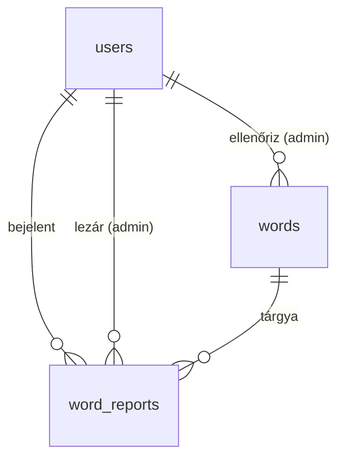

# Fázis 7 – Hibabejelentés és adminisztráció

A dolgozat központi állítása az, hogy a szókártyák tartalmát **ember ellenőrzi**. Ebben különbözik az alkalmazás azoktól a nyelvtanuló alkalmazásoktól, amelyek AI-val generált tananyagot használnak, és a felhasználói hibajelzésekre nem reagálnak. Ez a fázis ezt az állítást teszi ellenőrizhetővé és mérhetővé a rendszerben:

1. minden központi szónak van **ellenőrzöttségi állapota** (ki és mikor nézte át);
2. a felhasználó tanulás közben **hibát jelenthet** egy szóról, akár offline is;
3. az **admin** a bejelentések alapján javít, jóváhagy vagy elutasít, és válaszol a bejelentőnek;
4. a javítás a szinkronnal **minden eszközre eljut**, a bejelentő pedig látja a bejelentése sorsát.

## 1. Adatmodell (6. migráció: `20261031000000_admin_reports`)

| Elem | Leírás |
|---|---|
| `users.role` | `USER` / `ADMIN` |
| `words.review_status` | `UNREVIEWED` (alapértelmezés) / `VERIFIED` / `REJECTED`, mellette `reviewed_at`, `reviewed_by_id` |
| `word_reports` | bejelentés: szó, kártyatípus (opcionális), típus (`TRANSLATION`, `GRAMMAR`, `SPELLING`, `OTHER`), szabad szöveg (≤ 1000 karakter), állapot (`OPEN`, `RESOLVED`, `DISMISSED`), admin megjegyzés, időbélyegek, lezáró admin |

Kézi kényszerek: az üzenet nem lehet üres; `status = 'OPEN'` ⇔ `resolved_at IS NULL`; `review_status = 'UNREVIEWED'` ⇔ `reviewed_at IS NULL`.



**Tervezési döntések**

- **D1 – A bejelentés azonosítóját a kliens generálja.** A bejelentés offline is rögzíthető: a kimenő sorba (outbox) kerül, és a következő szinkronnal megy fel. Ismételt feltöltésnél a szerver `exists` választ ad, így nem keletkezik duplikátum.
- **D2 – Az elutasítás nem törlés.** Az elutasított szó (`REJECTED`) megmarad az adatbázisban, de a felhasználóknak nem látszik. A szinkron törölt szóként (tombstone) küldi le, ezért a kliensen a kártyái kikerülnek a tanulásból. A tanulási előzmény megmarad: ha az admin később mégis jóváhagyja a szót, az a következő szinkronnal visszakerül az eszközökre.
- **D3 – A szerepkört az adatbázisból olvassuk, nem a tokenből.** Az `AdminGuard` minden admin kérésnél lekérdezi a szerepkört. Így egy jogosultság visszavonása azonnal érvényes, nem csak a 15 perces access token lejártakor.
- **D4 – A verziózás a meglévő triggerekre épül.** A státusz módosítása a `touch_versioned_row()`, a jelentések cseréje a `touch_parent_word()` trigger miatt lépteti a szó verzióját. A szinkronhoz ezért nem kellett új mechanizmus.
- **D5 – A seed nem írja felül az ellenőrzött szót.** A `db:seed` és a `db:import` kihagyja a `VERIFIED` és a `REJECTED` szavakat, különben egy újrafuttatás visszaállítaná az admin javítását.

## 2. API

| Végpont | Ki | Leírás |
|---|---|---|
| `POST /reports` | felhasználó | bejelentés online; ismeretlen vagy nem látható szó → 404 |
| `GET /reports/mine` | felhasználó | saját bejelentések állapota és az admin válasza |
| `POST /sync/push` → `reports[]` | felhasználó | offline bejelentések; tételenkénti eredmény: `created` / `exists` / `rejected` (`id_required`, `id_conflict`, `unknown_word`) |
| `GET /admin/summary` | admin | szavak állapot szerint, bejelentések állapot és típus szerint, átlagos átfutási idő (óra) |
| `GET /admin/words` | admin | ellenőrzési sor: szűrés állapotra, szintre, szövegre, nyitott bejelentésre; gyakoriság szerinti sorrend |
| `PATCH /admin/words/:id` | admin | `reviewStatus` és/vagy `translations` (a jelentések teljes új listája); `expectedVersion` → 409 ütközésnél. A javítás állapot megadása nélkül ellenőrzöttnek jelöli a szót. |
| `GET /admin/reports` | admin | bejelentések állapot és típus szerint, a legrégebbi elöl |
| `PATCH /admin/reports/:id` | admin | lezárás (`RESOLVED` / `DISMISSED`) vagy újranyitás, megjegyzéssel |

A `GET /users/me` a `role` mezőt is visszaadja, a szavak JSON-ja pedig a `reviewStatus` mezőt (saját szónál ez `null`). Az adatexport a bejelentéseket is tartalmazza.

**Admin kinevezése** (szándékosan nem API-n keresztül: az első adminnak nincs kitől jogot kapnia):

```bash
cd backend
npm run user:role -- anna@example.hu ADMIN     # visszavonás: … USER
```

Az app az admin menüpontot a profil alapján mutatja, ezért a kinevezés után ki kell jelentkezni, majd újra be.

## 3. Mobilalkalmazás

- **Hibabejelentés:** tanulás közben a zászló ikon (*Hibát találtam*) nyit egy ablakot, amelyben a hiba típusa és egy leírás adható meg. A bejelentés helyben rögzül (`LocalStore.recordReport`, új `report` kimenő típus, helyi adatbázis v3), és a szinkron tölti fel. Régi szerver esetén, amely a `reports` mezőt nem ismeri, a bejelentés a sorban marad, nem vész el.
- **Bejelentéseim:** a menüből elérhető lista a bejelentések állapotával (*Feldolgozás alatt* / *Javítva* / *Nem hiba*) és az admin válaszával.
- **Adminisztráció** (csak admin felhasználónak látszik, csak online működik):
  - fejlécben összesítés (ellenőrzött / ellenőrizetlen / elutasított szavak, nyitott bejelentések, átlagos átfutás);
  - *Bejelentések* fül: állapot szerinti lista; egy bejelentésnél javítható a jelentés, jóváhagyható vagy elutasítható a szó, a bejelentés pedig megjegyzéssel lezárható;
  - *Szavak* fül: ellenőrzési sor szűrőkkel (ellenőrizetlen / bejelentett / ellenőrzött / elutasított) és kereséssel, soronként gyors *helyes* / *elutasítás* / *javítás* művelettel.

## 4. Ellenőrzés

| Teszt | Mit igazol |
|---|---|
| `backend/test/admin.e2e-spec.ts` (16 eset) | bejelentés REST-en és push-sal, idempotencia, elutasítási okok, kompatibilitás régi klienssel, export; 401/403, azonnali jogvisszavonás; bejelentés lezárása és újranyitása, összesítés; jóváhagyás, javítás → inkrementális pull új verzióval, 409 elavult verziónál, elutasítás → tombstone, 404, felvétel elutasítva, kikerül a napi sorból, visszaállítás után visszajön; saját szó nem ellenőrizhető |
| `mobile/test/sync/sync_engine_test.dart` | offline bejelentés feltöltése, hálózati hiba után újraküldés, elutasítás számolása, régi szerver esetén a sorban marad, üres üzenet tiltva |
| `mobile/test/data/migration_test.dart` | v2 → v3 migráció: a kimenő sor megmarad, és fogadja az új típust |
| `mobile/test/widgets/study_screen_test.dart` | a zászló gomb ablakot nyit, üres szöveget nem küld, a kártya adataival rögzít, a tanulás folytatódik |
| `mobile/test/e2e/multi_device_sync_test.dart` | valódi backenddel: offline bejelentés, majd szinkron; a másik eszközről is látszik |

## 5. A dolgozathoz: mit lehet ebből mérni?

- **A tartalom ellenőrzöttsége:** az ellenőrzött szavak aránya a teljes szókincsben (`GET /admin/summary` → `words`). Ez teszi alátámaszthatóvá a pontossági állítást a „100%” helyett.
- **Hibaarány:** a bejelentett és ténylegesen javított szavak aránya, hibatípusonként (`reportsByCategory`). Ez összevethető a konkurens alkalmazások szakirodalmi vagy saját gyűjtésű hibapéldáival.
- **Reakcióidő:** a bejelentés és a lezárás közti átlagos idő (`avgResolutionHours`). Ez közvetlen ellenpélda arra, amikor egy bejelentésre nem érkezik válasz.

## 6. Ismert korlátok

- Az admin a jelentéseket és az állapotot szerkesztheti. A nyelvtani adatok (névelő, többes szám, vonzat) javítása egyelőre a seed vagy az importfájl módosításával és újrafuttatásával lehetséges; ehhez előbb vissza kell állítani a szót `UNREVIEWED` állapotba, mert a seed az ellenőrzött szavakat kihagyja.
- Az `UNREVIEWED` szavak is megjelennek a felhasználóknak, mert a jelenlegi szókincs nagy része még nincs átnézve. Ha a teljes lista ellenőrzött, a `visibleWordsWhere()` egy feltétellel „csak ellenőrzött” módra állítható.
- Az admin felület az appon belül van, külön webes felület nincs.
