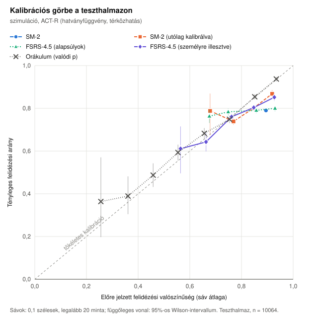
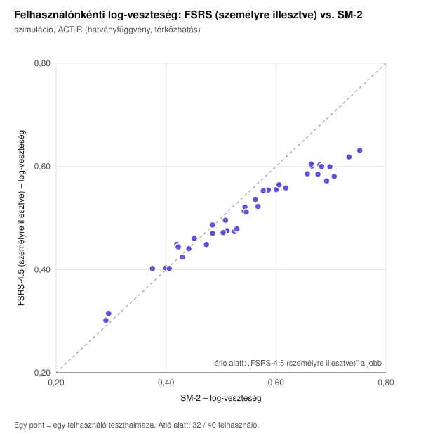
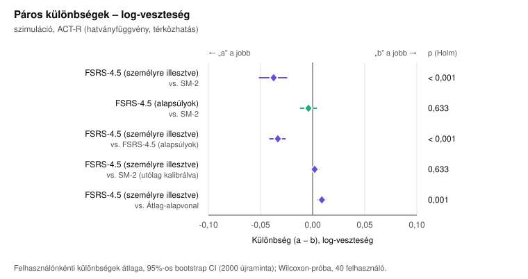
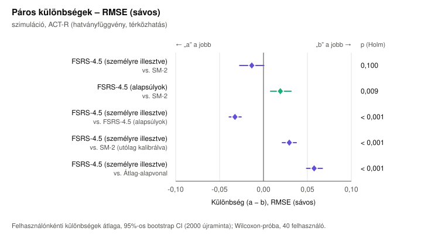
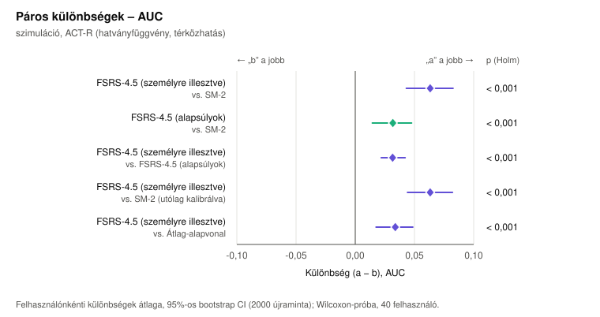

# Ütemezők összevetése – szimuláció, ACT-R (hatványfüggvény, térközhatás)

Adatforrás: 40 szimulált tanuló, 120 nap használat, a rendszer SM-2 ütemezője szerint ismételve; a felidézést a(z) ACT-R (hatványfüggvény, térközhatás) memóriamodell sorsolja (mag: 42). Lásd: `scripts/experiment/learner-simulation.ts`.

Felhasználók: **40** (kimaradt 0, mert 30-nál kevesebb teszt mintája volt; személyre illesztve: 40). Tanító minta: 38696, teszt minta: 10064, tényleges felidézési arány a teszthalmazon: 79,0%.

## Összesített mérőszámok a teszthalmazon

| Modell | log-veszteség ↓ | RMSE (sávos) ↓ | AUC ↑ | ECE ↓ | Brier ↓ | átl. előrejelzés |
|---|---:|---:|---:|---:|---:|---:|
| SM-2 | 0,5619 | 0,1053 | 0,4844 | 0,1048 | 0,1771 | 0,895 |
| SM-2 (utólag kalibrálva) | 0,5164 | 0,0453 | 0,5691 | 0,0424 | 0,1662 | 0,830 |
| FSRS-4.5 (alapsúlyok) | 0,5543 | 0,0923 | 0,5173 | 0,0816 | 0,1743 | 0,842 |
| FSRS-4.5 (személyre illesztve) | 0,5174 | 0,0478 | 0,5762 | 0,0359 | 0,1655 | 0,825 |
| Átlag-alapvonal | 0,5094 | 0,0215 | 0,5771 | 0,0171 | 0,1643 | 0,803 |
| Orákulum (valódi p) | 0,4670 | 0,0194 | 0,7106 | 0,0101 | 0,1503 | 0,782 |

## Páros összehasonlítás – log-veszteség (kisebb a jobb)

| a | b | felh. | átl. különbség (a − b) [95% CI] | medián | összesített különbség [95% CI] | „a” jobb | W⁺ | p | p (Holm) | r |
|---|---|---:|---|---:|---|---:|---:|---:|---:|---:|
| FSRS-4.5 (személyre illesztve) | SM-2 | 40 | -0,0374 [-0,0511; -0,0248] | -0,0319 | -0,0445 [-0,0591; -0,0298] | 80% | 81,0 | < 0,001 | < 0,001 | -0,80 |
| FSRS-4.5 (alapsúlyok) | SM-2 | 40 | -0,0040 [-0,0116; 0,0036] | -0,0049 | -0,0076 [-0,0156; 0,0007] | 57% | 345,0 | 0,386 | 0,633 | -0,16 |
| FSRS-4.5 (személyre illesztve) | FSRS-4.5 (alapsúlyok) | 40 | -0,0334 [-0,0411; -0,0264] | -0,0311 | -0,0369 [-0,0449; -0,0291] | 100% | 0,0 | < 0,001 | < 0,001 | -1,00 |
| FSRS-4.5 (személyre illesztve) | SM-2 (utólag kalibrálva) | 40 | +0,0019 [-0,0015; 0,0057] | +0,0016 | +0,0010 [-0,0027; 0,0045] | 43% | 485,0 | 0,317 | 0,633 | +0,18 |
| FSRS-4.5 (személyre illesztve) | Átlag-alapvonal | 40 | +0,0089 [0,0049; 0,0125] | +0,0087 | +0,0080 [0,0039; 0,0121] | 23% | 674,0 | < 0,001 | 0,001 | +0,64 |

## Páros összehasonlítás – RMSE (sávos) (kisebb a jobb)

| a | b | felh. | átl. különbség (a − b) [95% CI] | medián | összesített különbség [95% CI] | „a” jobb | W⁺ | p | p (Holm) | r |
|---|---|---:|---|---:|---|---:|---:|---:|---:|---:|
| FSRS-4.5 (személyre illesztve) | SM-2 | 40 | -0,0133 [-0,0271; 0,0005] | -0,0047 | -0,0576 [-0,0703; -0,0406] | 57% | 287,0 | 0,100 | 0,100 | -0,30 |
| FSRS-4.5 (alapsúlyok) | SM-2 | 40 | +0,0192 [0,0080; 0,0315] | +0,0134 | -0,0131 [-0,0213; -0,0020] | 33% | 623,0 | 0,004 | 0,009 | +0,52 |
| FSRS-4.5 (személyre illesztve) | FSRS-4.5 (alapsúlyok) | 40 | -0,0325 [-0,0391; -0,0254] | -0,0354 | -0,0445 [-0,0514; -0,0350] | 93% | 21,0 | < 0,001 | < 0,001 | -0,95 |
| FSRS-4.5 (személyre illesztve) | SM-2 (utólag kalibrálva) | 40 | +0,0294 [0,0214; 0,0374] | +0,0249 | +0,0025 [-0,0021; 0,0097] | 10% | 800,0 | < 0,001 | < 0,001 | +0,95 |
| FSRS-4.5 (személyre illesztve) | Átlag-alapvonal | 40 | +0,0577 [0,0490; 0,0671] | +0,0556 | +0,0263 [0,0187; 0,0346] | 0% | 820,0 | < 0,001 | < 0,001 | +1,00 |

## Páros összehasonlítás – AUC (nagyobb a jobb)

| a | b | felh. | átl. különbség (a − b) [95% CI] | medián | összesített különbség [95% CI] | „a” jobb | W⁺ | p | p (Holm) | r |
|---|---|---:|---|---:|---|---:|---:|---:|---:|---:|
| FSRS-4.5 (személyre illesztve) | SM-2 | 40 | +0,0633 [0,0431; 0,0826] | +0,0744 | +0,0918 [0,0712; 0,1099] | 80% | 711,0 | < 0,001 | < 0,001 | +0,82 |
| FSRS-4.5 (alapsúlyok) | SM-2 | 40 | +0,0317 [0,0144; 0,0475] | +0,0363 | +0,0329 [0,0175; 0,0495] | 78% | 660,0 | < 0,001 | < 0,001 | +0,61 |
| FSRS-4.5 (személyre illesztve) | FSRS-4.5 (alapsúlyok) | 40 | +0,0316 [0,0219; 0,0421] | +0,0168 | +0,0588 [0,0441; 0,0718] | 88% | 803,0 | < 0,001 | < 0,001 | +0,96 |
| FSRS-4.5 (személyre illesztve) | SM-2 (utólag kalibrálva) | 40 | +0,0633 [0,0441; 0,0821] | +0,0744 | +0,0071 [-0,0050; 0,0223] | 80% | 711,0 | < 0,001 | < 0,001 | +0,82 |
| FSRS-4.5 (személyre illesztve) | Átlag-alapvonal | 40 | +0,0338 [0,0176; 0,0486] | +0,0306 | -0,0010 [-0,0132; 0,0136] | 78% | 687,0 | < 0,001 | < 0,001 | +0,68 |

Jelmagyarázat: *felh.* – a párok (felhasználók) száma; *átl. különbség* – a felhasználónkénti mérőszám-különbségek átlaga, a felhasználók bootstrap újramintavételezéséből számolt 95%-os percentilis intervallummal; *összesített különbség* – az összes teszt mintán számolt mérőszámok különbsége, klaszter-bootstrap intervallummal; *„a” jobb* – a felhasználók hány százalékánál jobb az „a” modell; *W⁺, p* – Wilcoxon-féle előjeles rangpróba (kétoldali); *p (Holm)* – Holm–Bonferroni szerint korrigálva, mérőszámonként az összehasonlítások családján; *r* – illesztett párok rang-biszeriális korrelációja (hatásméret).

## Ábrák











## Futtatási paraméterek

```json
{
  "testFraction": 0.2,
  "minTrainSamples": 100,
  "minTestSamples": 30,
  "bootstrapResamples": 2000,
  "seed": 42,
  "calibrationBins": 10,
  "fit": {
    "iterations": 150
  }
}
```
