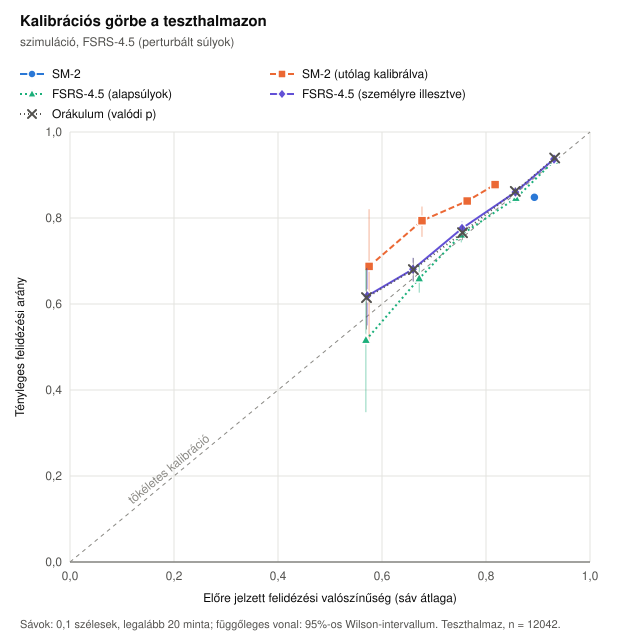
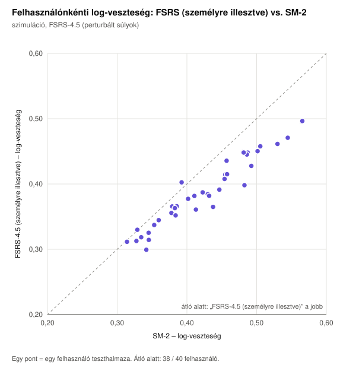
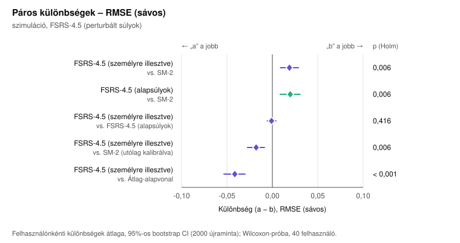
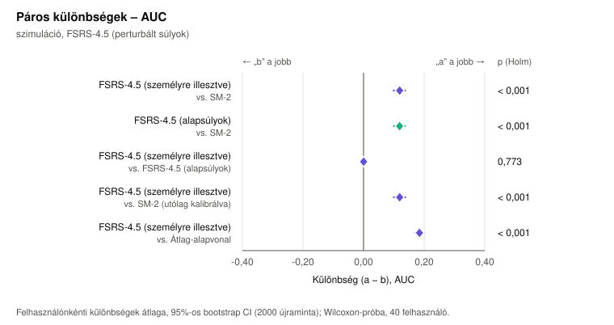

# Ütemezők összevetése – szimuláció, FSRS-4.5 (perturbált súlyok)

Adatforrás: 40 szimulált tanuló, 120 nap használat, a rendszer SM-2 ütemezője szerint ismételve; a felidézést a(z) FSRS-4.5 (perturbált súlyok) memóriamodell sorsolja (mag: 42). Lásd: `scripts/experiment/learner-simulation.ts`.

Felhasználók: **40** (kimaradt 0, mert 30-nál kevesebb teszt mintája volt; személyre illesztve: 40). Tanító minta: 45991, teszt minta: 12042, tényleges felidézési arány a teszthalmazon: 84,8%.

## Összesített mérőszámok a teszthalmazon

| Modell | log-veszteség ↓ | RMSE (sávos) ↓ | AUC ↑ | ECE ↓ | Brier ↓ | átl. előrejelzés |
|---|---:|---:|---:|---:|---:|---:|
| SM-2 | 0,4338 | 0,0465 | 0,5681 | 0,0451 | 0,1306 | 0,893 |
| SM-2 (utólag kalibrálva) | 0,4404 | 0,0743 | 0,5626 | 0,0732 | 0,1337 | 0,775 |
| FSRS-4.5 (alapsúlyok) | 0,3978 | 0,0147 | 0,6878 | 0,0076 | 0,1216 | 0,851 |
| FSRS-4.5 (személyre illesztve) | 0,3959 | 0,0169 | 0,6938 | 0,0108 | 0,1210 | 0,837 |
| Átlag-alapvonal | 0,4611 | 0,1113 | 0,5344 | 0,1093 | 0,1414 | 0,738 |
| Orákulum (valódi p) | 0,3937 | 0,0169 | 0,7002 | 0,0095 | 0,1204 | 0,839 |

## Páros összehasonlítás – log-veszteség (kisebb a jobb)

| a | b | felh. | átl. különbség (a − b) [95% CI] | medián | összesített különbség [95% CI] | „a” jobb | W⁺ | p | p (Holm) | r |
|---|---|---:|---|---:|---|---:|---:|---:|---:|---:|
| FSRS-4.5 (személyre illesztve) | SM-2 | 40 | -0,0366 [-0,0434; -0,0296] | -0,0344 | -0,0380 [-0,0449; -0,0308] | 95% | 4,0 | < 0,001 | < 0,001 | -0,99 |
| FSRS-4.5 (alapsúlyok) | SM-2 | 40 | -0,0350 [-0,0411; -0,0288] | -0,0330 | -0,0360 [-0,0424; -0,0295] | 93% | 6,0 | < 0,001 | < 0,001 | -0,99 |
| FSRS-4.5 (személyre illesztve) | FSRS-4.5 (alapsúlyok) | 40 | -0,0016 [-0,0034; 0,0001] | -0,0011 | -0,0019 [-0,0038; -0,0003] | 57% | 299,0 | 0,137 | 0,137 | -0,27 |
| FSRS-4.5 (személyre illesztve) | SM-2 (utólag kalibrálva) | 40 | -0,0446 [-0,0510; -0,0384] | -0,0422 | -0,0445 [-0,0514; -0,0383] | 100% | 0,0 | < 0,001 | < 0,001 | -1,00 |
| FSRS-4.5 (személyre illesztve) | Átlag-alapvonal | 40 | -0,0658 [-0,0743; -0,0573] | -0,0655 | -0,0652 [-0,0748; -0,0564] | 100% | 0,0 | < 0,001 | < 0,001 | -1,00 |

## Páros összehasonlítás – RMSE (sávos) (kisebb a jobb)

| a | b | felh. | átl. különbség (a − b) [95% CI] | medián | összesített különbség [95% CI] | „a” jobb | W⁺ | p | p (Holm) | r |
|---|---|---:|---|---:|---|---:|---:|---:|---:|---:|
| FSRS-4.5 (személyre illesztve) | SM-2 | 40 | +0,0188 [0,0089; 0,0288] | +0,0234 | -0,0295 [-0,0363; -0,0133] | 33% | 647,0 | 0,001 | 0,006 | +0,58 |
| FSRS-4.5 (alapsúlyok) | SM-2 | 40 | +0,0197 [0,0086; 0,0306] | +0,0201 | -0,0318 [-0,0376; -0,0160] | 35% | 634,0 | 0,003 | 0,006 | +0,55 |
| FSRS-4.5 (személyre illesztve) | FSRS-4.5 (alapsúlyok) | 40 | -0,0009 [-0,0057; 0,0039] | -0,0048 | +0,0023 [-0,0046; 0,0099] | 57% | 349,0 | 0,416 | 0,416 | -0,15 |
| FSRS-4.5 (személyre illesztve) | SM-2 (utólag kalibrálva) | 40 | -0,0178 [-0,0274; -0,0088] | -0,0187 | -0,0574 [-0,0631; -0,0431] | 73% | 179,0 | 0,002 | 0,006 | -0,56 |
| FSRS-4.5 (személyre illesztve) | Átlag-alapvonal | 40 | -0,0414 [-0,0534; -0,0301] | -0,0489 | -0,0944 [-0,1010; -0,0772] | 78% | 68,0 | < 0,001 | < 0,001 | -0,83 |

## Páros összehasonlítás – AUC (nagyobb a jobb)

| a | b | felh. | átl. különbség (a − b) [95% CI] | medián | összesített különbség [95% CI] | „a” jobb | W⁺ | p | p (Holm) | r |
|---|---|---:|---|---:|---|---:|---:|---:|---:|---:|
| FSRS-4.5 (személyre illesztve) | SM-2 | 40 | +0,1193 [0,0992; 0,1377] | +0,1228 | +0,1257 [0,1091; 0,1422] | 95% | 816,0 | < 0,001 | < 0,001 | +0,99 |
| FSRS-4.5 (alapsúlyok) | SM-2 | 40 | +0,1191 [0,0997; 0,1371] | +0,1166 | +0,1197 [0,1027; 0,1369] | 95% | 817,0 | < 0,001 | < 0,001 | +0,99 |
| FSRS-4.5 (személyre illesztve) | FSRS-4.5 (alapsúlyok) | 40 | +0,0002 [-0,0032; 0,0034] | +0,0014 | +0,0060 [0,0009; 0,0114] | 55% | 432,0 | 0,773 | 0,773 | +0,05 |
| FSRS-4.5 (személyre illesztve) | SM-2 (utólag kalibrálva) | 40 | +0,1193 [0,0995; 0,1382] | +0,1228 | +0,1312 [0,1078; 0,1530] | 95% | 816,0 | < 0,001 | < 0,001 | +0,99 |
| FSRS-4.5 (személyre illesztve) | Átlag-alapvonal | 40 | +0,1845 [0,1695; 0,1990] | +0,1834 | +0,1594 [0,1359; 0,1838] | 100% | 820,0 | < 0,001 | < 0,001 | +1,00 |

Jelmagyarázat: *felh.* – a párok (felhasználók) száma; *átl. különbség* – a felhasználónkénti mérőszám-különbségek átlaga, a felhasználók bootstrap újramintavételezéséből számolt 95%-os percentilis intervallummal; *összesített különbség* – az összes teszt mintán számolt mérőszámok különbsége, klaszter-bootstrap intervallummal; *„a” jobb* – a felhasználók hány százalékánál jobb az „a” modell; *W⁺, p* – Wilcoxon-féle előjeles rangpróba (kétoldali); *p (Holm)* – Holm–Bonferroni szerint korrigálva, mérőszámonként az összehasonlítások családján; *r* – illesztett párok rang-biszeriális korrelációja (hatásméret).

## Ábrák










## Futtatási paraméterek

```json
{
  "testFraction": 0.2,
  "minTrainSamples": 100,
  "minTestSamples": 30,
  "bootstrapResamples": 2000,
  "seed": 42,
  "calibrationBins": 10,
  "fit": {
    "iterations": 150
  }
}
```
