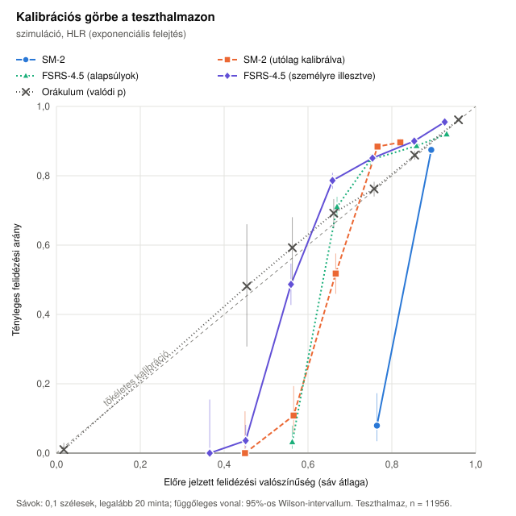
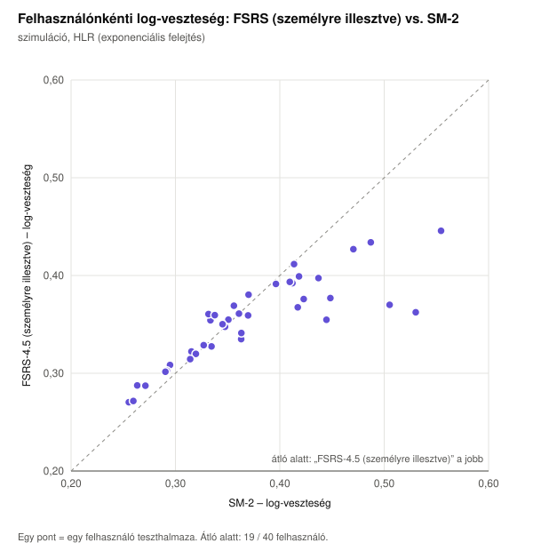
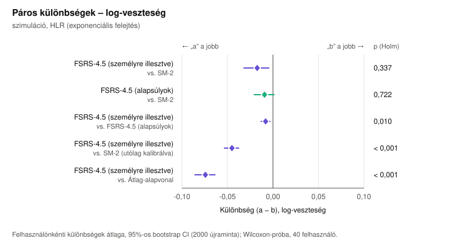
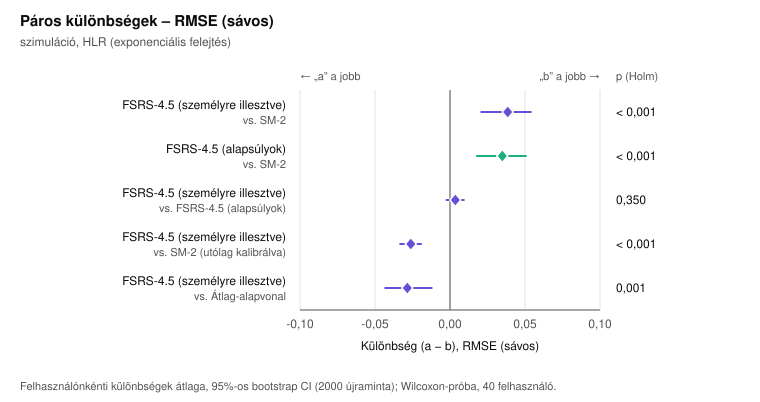
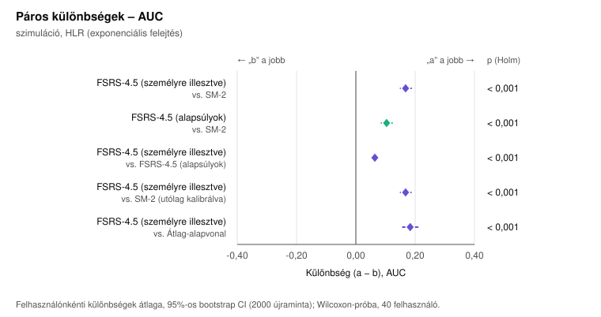

# Ütemezők összevetése – szimuláció, HLR (exponenciális felejtés)

Adatforrás: 40 szimulált tanuló, 120 nap használat, a rendszer SM-2 ütemezője szerint ismételve; a felidézést a(z) HLR (exponenciális felejtés) memóriamodell sorsolja (mag: 42). Lásd: `scripts/experiment/learner-simulation.ts`.

Felhasználók: **40** (kimaradt 0, mert 30-nál kevesebb teszt mintája volt; személyre illesztve: 40). Tanító minta: 45833, teszt minta: 11956, tényleges felidézési arány a teszthalmazon: 87,0%.

## Összesített mérőszámok a teszthalmazon

| Modell | log-veszteség ↓ | RMSE (sávos) ↓ | AUC ↑ | ECE ↓ | Brier ↓ | átl. előrejelzés |
|---|---:|---:|---:|---:|---:|---:|
| SM-2 | 0,3796 | 0,0937 | 0,5578 | 0,0234 | 0,1113 | 0,893 |
| SM-2 (utólag kalibrálva) | 0,4051 | 0,1254 | 0,5846 | 0,1140 | 0,1180 | 0,772 |
| FSRS-4.5 (alapsúlyok) | 0,3666 | 0,0772 | 0,6576 | 0,0390 | 0,1068 | 0,852 |
| FSRS-4.5 (személyre illesztve) | 0,3583 | 0,0902 | 0,7133 | 0,0679 | 0,1044 | 0,816 |
| Átlag-alapvonal | 0,4357 | 0,1304 | 0,5553 | 0,1297 | 0,1298 | 0,740 |
| Orákulum (valódi p) | 0,2895 | 0,0158 | 0,8123 | 0,0051 | 0,0852 | 0,865 |

## Páros összehasonlítás – log-veszteség (kisebb a jobb)

| a | b | felh. | átl. különbség (a − b) [95% CI] | medián | összesített különbség [95% CI] | „a” jobb | W⁺ | p | p (Holm) | r |
|---|---|---:|---|---:|---|---:|---:|---:|---:|---:|
| FSRS-4.5 (személyre illesztve) | SM-2 | 40 | -0,0173 [-0,0320; -0,0045] | +0,0001 | -0,0214 [-0,0389; -0,0062] | 48% | 307,0 | 0,168 | 0,337 | -0,25 |
| FSRS-4.5 (alapsúlyok) | SM-2 | 40 | -0,0093 [-0,0206; 0,0013] | +0,0024 | -0,0131 [-0,0267; -0,0013] | 40% | 383,0 | 0,722 | 0,722 | -0,07 |
| FSRS-4.5 (személyre illesztve) | FSRS-4.5 (alapsúlyok) | 40 | -0,0081 [-0,0131; -0,0033] | -0,0084 | -0,0083 [-0,0141; -0,0032] | 73% | 190,0 | 0,003 | 0,010 | -0,54 |
| FSRS-4.5 (személyre illesztve) | SM-2 (utólag kalibrálva) | 40 | -0,0450 [-0,0533; -0,0377] | -0,0386 | -0,0468 [-0,0561; -0,0383] | 100% | 0,0 | < 0,001 | < 0,001 | -1,00 |
| FSRS-4.5 (személyre illesztve) | Átlag-alapvonal | 40 | -0,0743 [-0,0858; -0,0637] | -0,0645 | -0,0774 [-0,0915; -0,0655] | 100% | 0,0 | < 0,001 | < 0,001 | -1,00 |

## Páros összehasonlítás – RMSE (sávos) (kisebb a jobb)

| a | b | felh. | átl. különbség (a − b) [95% CI] | medián | összesített különbség [95% CI] | „a” jobb | W⁺ | p | p (Holm) | r |
|---|---|---:|---|---:|---|---:|---:|---:|---:|---:|
| FSRS-4.5 (személyre illesztve) | SM-2 | 40 | +0,0385 [0,0208; 0,0538] | +0,0576 | -0,0034 [-0,0213; 0,0208] | 28% | 685,0 | < 0,001 | < 0,001 | +0,67 |
| FSRS-4.5 (alapsúlyok) | SM-2 | 40 | +0,0349 [0,0180; 0,0505] | +0,0559 | -0,0165 [-0,0318; 0,0073] | 28% | 680,0 | < 0,001 | < 0,001 | +0,66 |
| FSRS-4.5 (személyre illesztve) | FSRS-4.5 (alapsúlyok) | 40 | +0,0036 [-0,0023; 0,0092] | +0,0021 | +0,0131 [0,0052; 0,0202] | 45% | 480,0 | 0,350 | 0,350 | +0,17 |
| FSRS-4.5 (személyre illesztve) | SM-2 (utólag kalibrálva) | 40 | -0,0261 [-0,0332; -0,0193] | -0,0296 | -0,0351 [-0,0431; -0,0273] | 88% | 45,0 | < 0,001 | < 0,001 | -0,89 |
| FSRS-4.5 (személyre illesztve) | Átlag-alapvonal | 40 | -0,0284 [-0,0432; -0,0122] | -0,0367 | -0,0401 [-0,0608; -0,0179] | 85% | 154,0 | < 0,001 | 0,001 | -0,62 |

## Páros összehasonlítás – AUC (nagyobb a jobb)

| a | b | felh. | átl. különbség (a − b) [95% CI] | medián | összesített különbség [95% CI] | „a” jobb | W⁺ | p | p (Holm) | r |
|---|---|---:|---|---:|---|---:|---:|---:|---:|---:|
| FSRS-4.5 (személyre illesztve) | SM-2 | 40 | +0,1679 [0,1505; 0,1867] | +0,1593 | +0,1555 [0,1383; 0,1767] | 100% | 820,0 | < 0,001 | < 0,001 | +1,00 |
| FSRS-4.5 (alapsúlyok) | SM-2 | 40 | +0,1038 [0,0860; 0,1223] | +0,1037 | +0,0999 [0,0822; 0,1205] | 95% | 816,0 | < 0,001 | < 0,001 | +0,99 |
| FSRS-4.5 (személyre illesztve) | FSRS-4.5 (alapsúlyok) | 40 | +0,0641 [0,0545; 0,0737] | +0,0546 | +0,0556 [0,0462; 0,0662] | 98% | 818,0 | < 0,001 | < 0,001 | +1,00 |
| FSRS-4.5 (személyre illesztve) | SM-2 (utólag kalibrálva) | 40 | +0,1679 [0,1506; 0,1860] | +0,1593 | +0,1287 [0,1109; 0,1508] | 100% | 820,0 | < 0,001 | < 0,001 | +1,00 |
| FSRS-4.5 (személyre illesztve) | Átlag-alapvonal | 40 | +0,1832 [0,1582; 0,2088] | +0,1560 | +0,1579 [0,1268; 0,1926] | 100% | 820,0 | < 0,001 | < 0,001 | +1,00 |

Jelmagyarázat: *felh.* – a párok (felhasználók) száma; *átl. különbség* – a felhasználónkénti mérőszám-különbségek átlaga, a felhasználók bootstrap újramintavételezéséből számolt 95%-os percentilis intervallummal; *összesített különbség* – az összes teszt mintán számolt mérőszámok különbsége, klaszter-bootstrap intervallummal; *„a” jobb* – a felhasználók hány százalékánál jobb az „a” modell; *W⁺, p* – Wilcoxon-féle előjeles rangpróba (kétoldali); *p (Holm)* – Holm–Bonferroni szerint korrigálva, mérőszámonként az összehasonlítások családján; *r* – illesztett párok rang-biszeriális korrelációja (hatásméret).

## Ábrák











## Futtatási paraméterek

```json
{
  "testFraction": 0.2,
  "minTrainSamples": 100,
  "minTestSamples": 30,
  "bootstrapResamples": 2000,
  "seed": 42,
  "calibrationBins": 10,
  "fit": {
    "iterations": 150
  }
}
```
